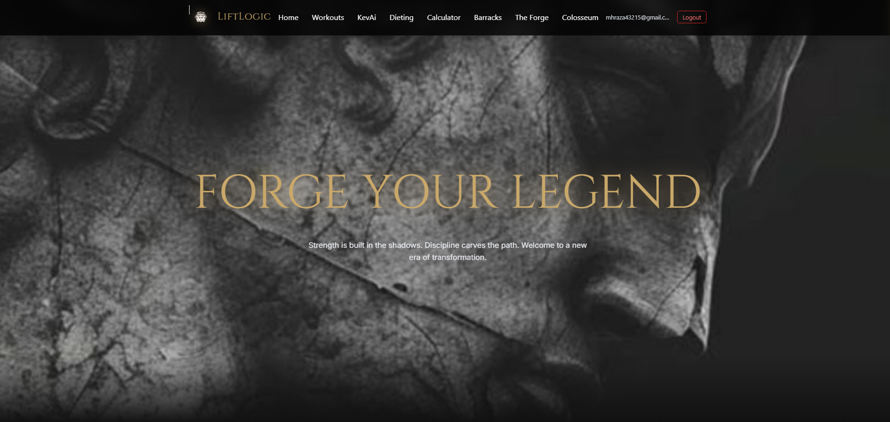
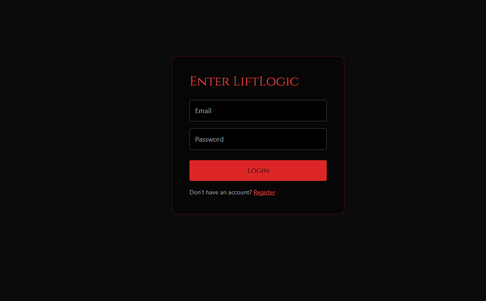
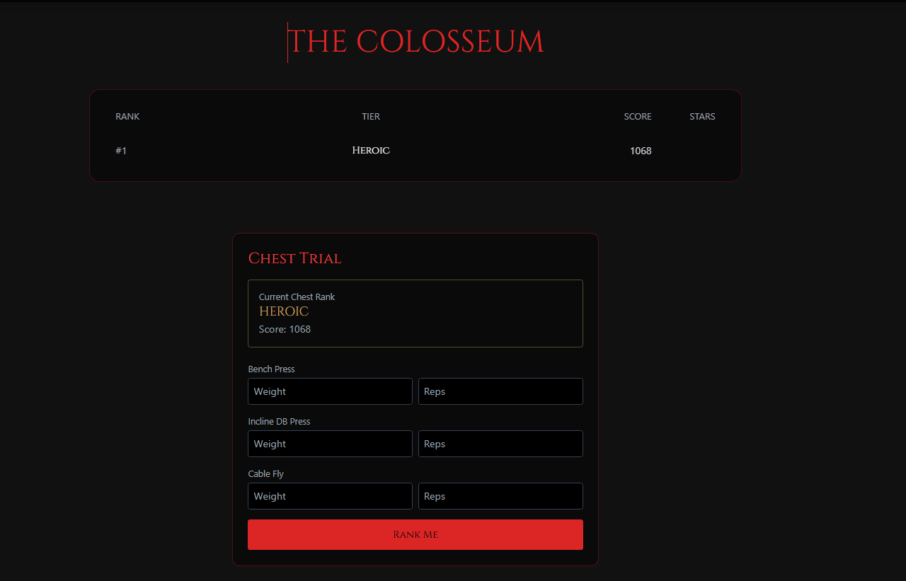

# CS 499 Computer Science Capstone — ePortfolio

**Muhammad Hamza** · Southern New Hampshire University · Computer Science

---

## Navigation

- [Code Review](code-review.md)
- [Artifacts: Original and Enhanced Code](artifacts.md)
- [Narrative — Enhancement One: Software Design and Engineering](narratives/enhancement-1-software-design.md)
- [Narrative — Enhancement Two: Algorithms and Data Structures](narratives/enhancement-2-algorithms.md)
- [Narrative — Enhancement Three: Databases](narratives/enhancement-3-databases.md)

---

## LiftLogic — A Quick Look

*The home page.*

*Login, hardened in Enhancement One with server-side validation and rate limiting, and in Enhancement Three with a database-level case-insensitive email constraint.*

*The Colosseum — the strength-ranking feature at the center of Enhancements Two and Three. The tier and score shown here are produced by the redesigned ranking engine (Enhancement Two) and saved through the atomic, concurrency-safe cooldown write proven out in Enhancement Three.*

---

## Professional Self-Assessment

Completing the Computer Science program at SNHU, and this capstone in particular, has sharpened a specific professional identity for me: I am most effective as a developer who can take over an existing, imperfect codebase, understand it rigorously before changing it, and prove — with real tests and real evidence, not assumptions — that my changes are correct. That identity did not exist in the same form before this course. It was built across three deliberately different kinds of work: hardening the software design of a full-stack web application, redesigning its ranking algorithm, and safely migrating its database schema under a live-data constraint. Together with the rest of my program coursework, these experiences have shaped both what I am good at and what kind of role I want next.

### Collaborating in a Team Environment

The artifact at the center of this ePortfolio, LiftLogic, began as a team project in CS 465 with a classmate, **Emiliano Chabolla**. We split ownership along the stack: I built the core frontend features — the calculator, the workouts page, the homepage, and page transitions — while Emiliano built the backend functionality those features depended on, including the Colosseum ranking system, the leaderboard, and authentication. That split meant we constantly had to agree on shared contracts (API shapes, response formats, what data a page could expect to receive) before either of us could work independently without breaking the other's half of the app. When the course ended, Emiliano gave me permission to continue developing LiftLogic on my own for this capstone, which meant I inherited not just his backend code but his design decisions, including some I had to later identify as weaknesses during Milestone One's code review — for example, the ranking cooldown logic he wrote worked for a single request at a time but had no protection against two simultaneous requests, a gap I closed in Enhancement Three.

That experience shaped how I approach any codebase I didn't fully write myself: read it rigorously before trusting it, and verify behavior with tests rather than assuming the original author covered every case.

### Communicating with Stakeholders

This capstone required communicating the same technical work to several different audiences, each needing a different level of detail. The code review video was written for a peer or manager audience: I explained what the code did and why an enhancement mattered without assuming deep familiarity with the implementation. The three enhancement narratives were written for an instructor audience evaluating specific course outcomes, so they needed to name concrete evidence — test counts, benchmark numbers, query plans — rather than general claims like "the code is faster now." And throughout the database enhancement especially, I had to write migration plans and "before you approve" checkpoints that functioned as stakeholder communication in miniature: a non-technical or cautious reader needed to be able to see exactly what a change would do to real data before approving it, including what could not be undone.

### Data Structures and Algorithms

The algorithms and data structures enhancement replaced a linear tier-lookup scan with binary search and replaced a sort-then-slice leaderboard query with a min-heap-based top-K selection, each justified with real comparator counts and benchmark evidence rather than intuition. Before touching the ranking engine, I pinned its exact existing behavior with 791 reproduced golden-master fixture entries, so later changes could be checked against proven-correct history instead of my own assumption of what the old code did. I also used property-based testing — thousands of seeded random inputs — and mutation testing to confirm the test suite would actually catch a deliberately broken implementation. This work also surfaced a genuine bug in the original code: a non-monotonic tier anchor hidden behind dead-code logic that could let a user skip nine tiers from a 0.02-pound difference in a single lift.

### Software Engineering and Database

The software design enhancement consolidated duplicated exercise-page logic behind a single, tested API client and hardened the Express server with input validation, rate limiting, and the removal of credential logging. The database enhancement is the one I would point to first as evidence of production-level engineering judgment: I split the work into an additive migration (new columns and tables only) and a separate destructive migration (drops only), gated behind verification, so nothing irreversible could happen before its replacement was proven working. I closed a real concurrency vulnerability — a race condition letting two simultaneous requests both pass a cooldown check — and proved the fix with real concurrent requests against a disposable test database, including a deliberately broken "control" version shown to fail ten times out of ten.

### Security

Security ran as a thread through all three enhancements rather than as a separate, bolted-on category: rate limiting and credential-logging removal in the first enhancement, a database-level case-insensitive email uniqueness constraint and the closed ranking race condition in the third, and a leaderboard response field removed because it was unnecessarily exposing other users' identifying information. I treated every database-touching command in this project as something that needed a reviewed, written plan before it ran against any real data, and kept a completely separate, disposable test database for all migration and concurrency testing.

### How the Artifacts Fit Together

All three enhancements in this ePortfolio were made to a single artifact, LiftLogic, rather than three unrelated projects, to show that I can reason about a system holistically — a database decision in the third enhancement had to respect a ranking engine already redesigned in the second, which in turn had to respect an API contract hardened in the first. The sections linked above present that progression in order: the code review that identified where the application was weak, then each enhancement narrative in sequence.

### Looking Forward

I'm entering the job search aiming for a role as a **web developer**. This capstone is the clearest evidence I have that I can own a real system end to end: find its weaknesses honestly, plan changes that respect existing data and existing users, and verify — with tests, benchmarks, and real-database proof — that those changes actually do what I claim.

*AI use: I used Claude (Anthropic) to help organize and draft this self-assessment and this site from the real details of my enhancement work, which I reviewed and personalized. I also used an AI coding agent (Claude Code), directed and reviewed by me at every step, to carry out the three artifact enhancements described throughout this ePortfolio.*